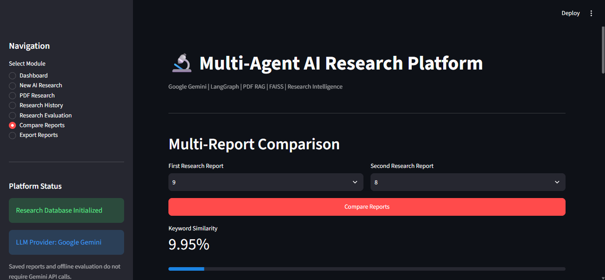
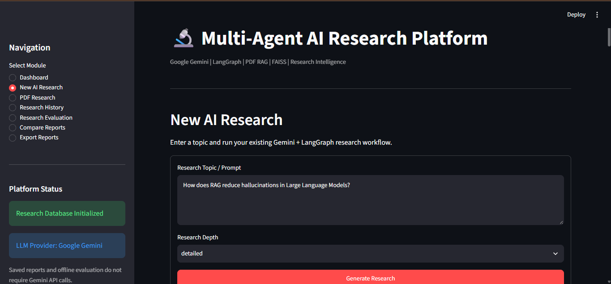
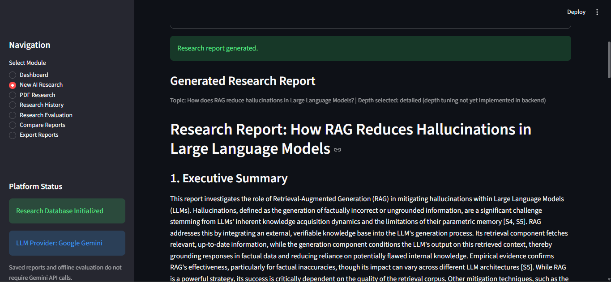
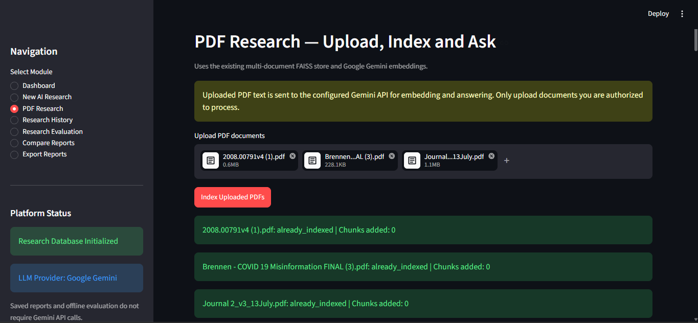
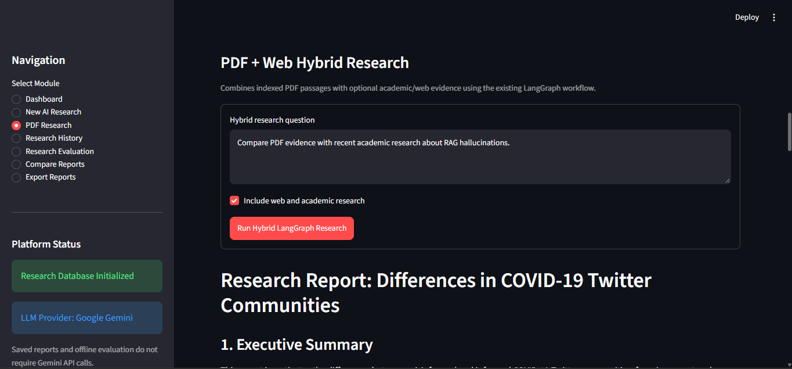

# Multi-Agent AI Research Platform

**An agentic research assistant built with Python, LangGraph, Google Gemini, retrieval-augmented generation (RAG), FAISS, SQLite, and Streamlit.**

The platform brings together academic research retrieval and evidence from uploaded PDFs, then generates research reports with source references. It also maintains research history, retrieves related past work, extracts a knowledge graph, and provides tools to evaluate and compare reports.

> **Project status:** Local end-to-end hybrid research execution has been demonstrated. Latest reported automated test run: **124 passed, 1 skipped, 0 failed** (Python 3.12.3; 23.31 seconds). The live Gemini connection test was skipped to conserve API quota. These results do not establish that every generated citation is factually correct.

## Features

- **Multi-agent orchestration:** LangGraph workflows for planning, research collection, evidence fusion, analysis, report generation, and memory updates.
- **Academic research:** Retrieves candidates from arXiv, Wikipedia, and Crossref, with deduplication, relevance filtering, caching, and quality metrics.
- **Multi-document PDF RAG:** Extracts PDF text, creates overlapping chunks, embeds passages with Google Gemini, and indexes normalized vectors in FAISS.
- **Hybrid evidence:** Combines retrieved PDF passages with academic/web research in one report-generation workflow.
- **Persistent research memory:** Stores reports and history in SQLite, with semantic retrieval of related research.
- **Knowledge graph:** Extracts entities and relationships from research outputs.
- **Research evaluation:** Report quality analysis, source credibility checks, research gap identification, contradiction heuristics, and report comparison.
- **Streamlit interface:** Dashboard, New AI Research, PDF Research, Research History, Research Evaluation, Compare Reports, and Export Reports.
- **Quota-aware operation:** Gemini response retry logic and embedding retry handling. Free-tier rate limits still apply.

## Architecture

```text
                           Streamlit UI (app.py)
                                   |
                      LangGraph Research Workflows
                                   |
              +--------------------+--------------------+
              |                    |                    |
        Memory Retrieval     Planning / Research     PDF RAG Retrieval
              |                    |                    |
        SQLite / Semantic    arXiv / Wikipedia       PDF -> Chunks
             Memory             / Crossref                 |
              |                    |                Gemini Embeddings
              |                    |                       |
              |                    |                     FAISS
              +--------------------+--------------------+
                                   |
                             Evidence Fusion
                                   |
                            Analysis / Report
                                   |
                    Save History + Knowledge Graph
                                   |
                       Evaluation / Comparison / Export
```

**Typical hybrid research flow:** User question → related research memory → planning → academic retrieval + PDF retrieval → evidence fusion → Gemini-based analysis and report → SQLite save → knowledge graph extraction.

## Technology Stack

| Layer | Technologies |
| --- | --- |
| Language | Python 3.12 |
| User interface | Streamlit |
| Agent orchestration | LangGraph |
| LLM and embeddings | Google Gemini API |
| Document retrieval | PDF text extraction, chunking, FAISS, NumPy |
| Academic sources | arXiv, Wikipedia, Crossref |
| Persistence | SQLite, FAISS index, local metadata |
| Testing | pytest |
| Local development | VS Code, Windows PowerShell |

**LLM provider:** Google Gemini only. No NVIDIA API is required. **Docker is not required.**

## Project Layout

```text
Multi-Agent-AI-Research-Platform/
├── app.py                        # Streamlit interface
├── app/
│   ├── core/                     # Gemini client and retry handling
│   ├── rag/                      # PDF loading, chunking, embeddings, FAISS
│   ├── services/                 # Research retrieval and hybrid fusion
│   └── workflows/                # LangGraph orchestration
├── tests/                        # Automated tests
├── data/                         # Local runtime data (do not commit)
├── .env.example                  # Configuration template
├── .gitignore
├── pytest.ini
├── requirements.txt
└── README.md
```

> This is a high-level layout; see the repository for the exact module names.

## Requirements

- Python 3.12 recommended (latest verified test environment)
- VS Code or another Python IDE
- Google Gemini API key with available quota
- Internet connection for Gemini and academic research APIs
- Windows PowerShell commands below; adapt activation syntax on macOS/Linux

## Local Installation (Windows PowerShell)

```powershell
git clone https://github.com/rajsinghv1/Multi-Agent-AI-Research-Platform.git
cd Multi-Agent-AI-Research-Platform
py -3.12 -m venv .venv
.\.venv\Scripts\Activate.ps1
python -m pip install --upgrade pip
python -m pip install -r requirements.txt
```

If PowerShell blocks virtual environment activation, use the interpreter directly instead:

```powershell
.\.venv\Scripts\python.exe -m pip install -r requirements.txt
```

## Environment Configuration

Copy the template:

```powershell
Copy-Item .env.example .env
```

Open `.env.example` and copy its **actual variable names** into `.env`, then set your Google Gemini API key. A common configuration uses `GOOGLE_API_KEY`, but **use the name expected by this repository's configuration code**; do not assume that an example name is wired up.

Never commit `.env`, API keys, credentials, uploaded PDFs, SQLite databases, or FAISS vector indexes. Check `.gitignore` before publishing.

## Run the Application

```powershell
python -m streamlit run app.py
```

Open the local URL printed in your terminal (commonly `http://localhost:8501`).

### Example workflows

**Academic research**

1. Open **New AI Research**.
2. Enter a research question, for example: *What are the key approaches to reducing hallucinations in retrieval-augmented generation?*
3. Run research and inspect retrieved sources, report, and warnings.
4. Find the saved result under **Research History**.

**PDF + Web Hybrid Research**

1. Open **PDF Research** and upload a PDF containing selectable text.
2. Index the PDF and wait for completion. Large documents may hit Gemini embedding rate limits.
3. Enter a question such as: *Compare the uploaded paper's findings with relevant academic literature. Identify agreements, contradictions, limitations, and research gaps. Cite the evidence used.*
4. Enable academic/web research if desired, then run the hybrid workflow.
5. Inspect the report, PDF evidence, source references, and any retrieval warnings. Verify page numbers and citations against original documents.

**Evaluation and comparison**

Use **Research Evaluation** to assess a report, or **Compare Reports** to compare saved outputs. These are decision-support heuristics, not a substitute for independent fact-checking or peer review.

## Application Screenshots

### 1. Research Intelligence Dashboard


### 2. New AI Research


### 3. AI-Generated Research Report


### 4. Multi-Document PDF Research


### 5. PDF + Web Hybrid Research


### 6. Multi-Report Comparison


## Automated Tests

Run all local tests:

```powershell
python -m pytest tests -v
```

**Most recent user-reported result:**

```text
collected 125 items
124 passed, 1 skipped in 23.31s
```

The skipped test checks a live Gemini connection and was disabled to avoid consuming API quota. Other tests exercise quota behavior, retrieval utilities, PDF/FAISS functionality, evidence fusion, memory, knowledge graph, report evaluation, and comparison. Mocked/offline tests do not guarantee that external APIs are available or that every generated report is accurate.

## Example Observed Hybrid Run

A completed local workflow reported:

```text
Academic sources retained: 3
PDF passages retrieved: 5
Related research memories: 3
Saved research ID: 8
Knowledge graph entities extracted: 26
Knowledge graph relationships extracted: 24
```

These values are from **one observed run**, not benchmarks or guaranteed output. The same run reported low average academic-source relevance (0.1161), so retrieval ranking remains an improvement area.

## Troubleshooting

| Issue | What to try |
| --- | --- |
| Gemini HTTP 429 `RESOURCE_EXHAUSTED` | Respect the `retryDelay`, reduce request frequency, retry later, and review free-tier limits. |
| Embedding requests exceed per-minute quota | Index smaller batches or one PDF at a time; ensure retry/throttling is applied to individual embedding calls. |
| `ModuleNotFoundError` | Activate the correct `.venv` and reinstall `requirements.txt`. |
| No PDF passages retrieved | Confirm indexing finished, text is extractable, and the PDF store matches the retrieval workflow. |
| FAISS dimension mismatch | Keep the embedding model and vector dimensions consistent with the existing index; rebuild only when intentionally migrating models. |
| Academic sources irrelevant | Refine the question and review source filtering/relevance thresholds. |
| Streamlit form button remains disabled | Avoid depending on checkbox state changes within the same form to enable its submit button. |

## Security and Responsible Use

- Keep credentials in local environment variables or `.env`; never publish real keys.
- Do not commit private PDFs, cached document text, local databases, or vector stores without explicit authorization.
- Treat retrieved web pages and PDF text as untrusted input; review model outputs before sharing.
- Verify research claims, citation URLs, and PDF page references against originals.
- Respect academic content licenses and third-party API terms.

## Known Limitations / Future Improvements

- Free-tier Gemini quotas can interrupt large-scale indexing or report generation.
- Academic source relevance and citation grounding require further validation.
- Scanned/image-only PDFs may require OCR support not covered by text-only extraction.
- Research evaluation and contradiction detection are heuristic and may miss errors.
- Potential improvements: per-call embedding throttling/batching, citation-grounding evaluation, source reranking, end-to-end live tests, and richer report export.


## Author

**Raj Singh** — [GitHub](https://github.com/rajsinghv1)

